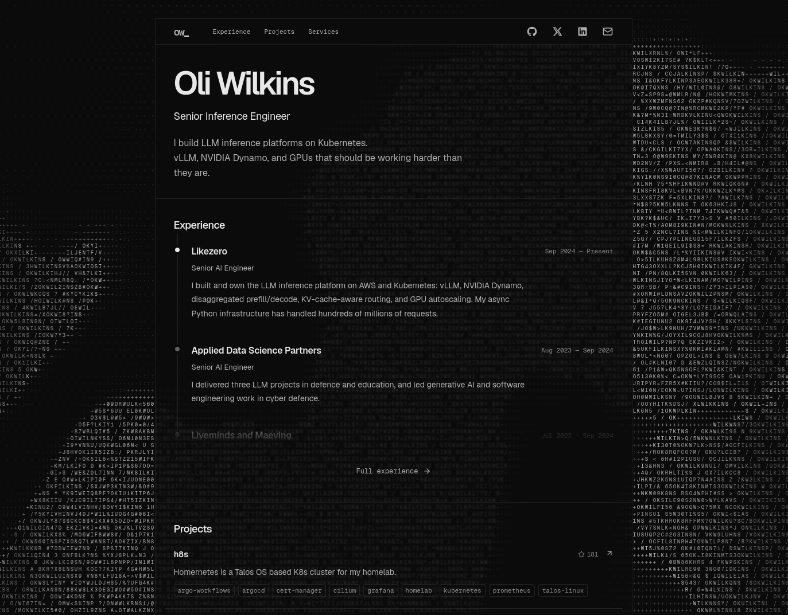

# okwilkins.dev

[](https://okwilkins.dev)

[Visit the website](https://okwilkins.dev)

Built with Next.js, React, TypeScript, Tailwind CSS and shadcn/ui.

## Run the website

Install [Nix](https://nixos.org/download/), then run:

```sh
nix develop --command run-site
```

This installs dependencies and starts the site at [localhost:3000](http://localhost:3000).

## Content

- Profile and experience: [data/site.ts](data/site.ts).
- Projects: my [GitHub pins](https://github.com/okwilkins), with descriptions, stars and topics. h8s, .dotfiles and inferlace stay first.
- Services: public Cloudflare routes in [h8s](https://github.com/okwilkins/h8s). Descriptions live in `data/site.ts`.

GitHub data is fetched on the server and cached for an hour.

## Check

```sh
nix develop --command pnpm check
nix develop --command pnpm test
nix develop --command pnpm build
```

## Build an image

```sh
docker build -t personal-website:local .
docker run --rm -p 3000:3000 personal-website:local
```

The Node service listens on port 3000. Health checks use `/healthz` and Prometheus uses `/metrics`. JSON logs go to stdout. Set `LOG_LEVEL` to change the log level.
